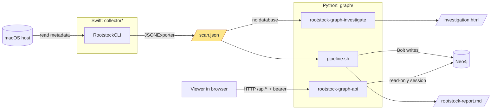
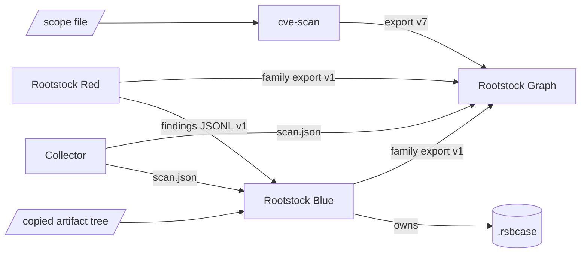
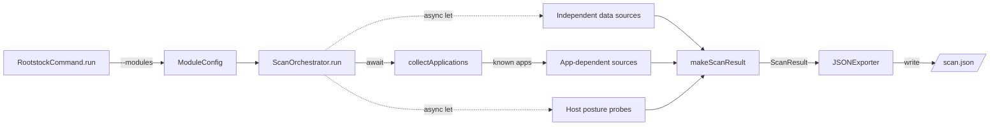
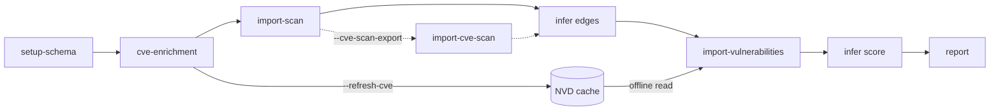
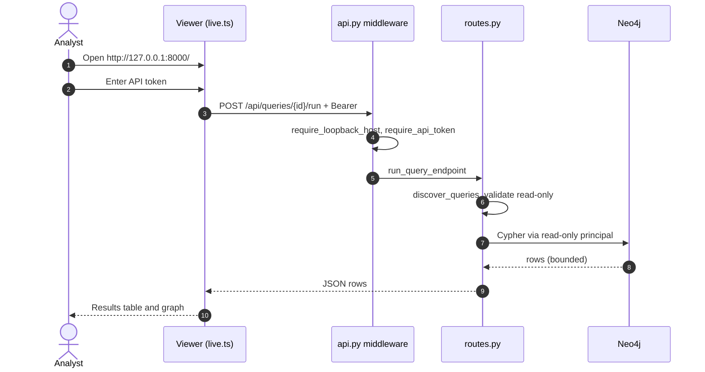
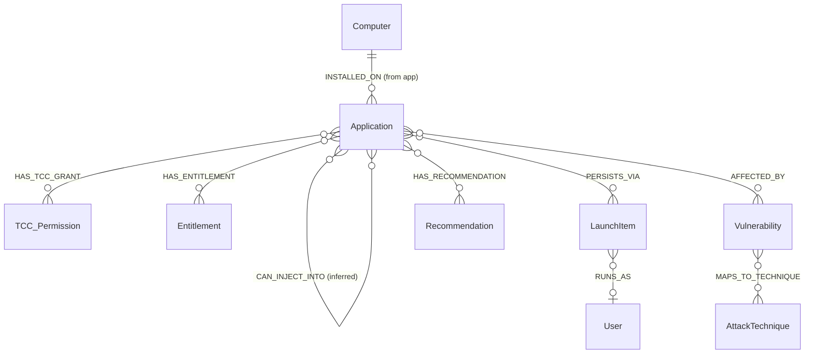
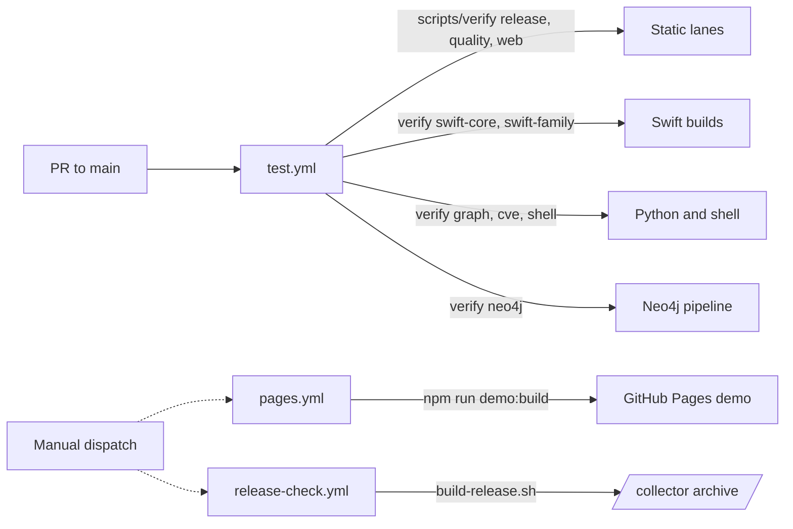

# Architecture

Rootstock separates host collection, graph analysis, CVE scanning, assessment,
and incident cases into independently built tools. They exchange the file
formats defined in [`contracts/`](../contracts/README.md).

If you are new, read this page top to bottom: the first two diagrams show
what runs where, the journeys show what happens when you run a command or
click in the viewer, and the code map at the end says where to start reading.

## System overview

What runs where in a Core run, and how the pieces talk:

`scan.json` is the hinge: the collector writes it once, and every later step
reads it as a file. The offline investigation needs no database; the graph
path loads the scan into Neo4j, which the API then serves to the viewer on
loopback only. All Python commands are console scripts of the one `graph`
package.

Where in the code:
[collector/Sources/RootstockCLI/RootstockCommand.swift](../collector/Sources/RootstockCLI/RootstockCommand.swift),
[graph/pipeline.sh](../graph/pipeline.sh),
[graph/src/rootstock_graph/investigation/cli.py](../graph/src/rootstock_graph/investigation/cli.py),
[graph/src/rootstock_graph/api.py](../graph/src/rootstock_graph/api.py),
[graph/docker-compose.yml](../graph/docker-compose.yml),
[graph/pyproject.toml](../graph/pyproject.toml) (`[project.scripts]`).

## Product family handoffs

Which other tools feed the graph, and through which files:

Every arrow between products is an explicit file handoff. A Core graph run
does not invoke cve-scan, Red, or Blue; their exports are imported with
`pipeline.sh --cve-scan-export` or `rootstock-graph-import-family-export`.
Blue keeps its case records separately from Neo4j, and each export has its own
format (see [Contracts and compatibility](#contracts-and-compatibility)).

## Components

| Path | Responsibility | Data and dependencies |
| --- | --- | --- |
| `collector/` | Local Swift host collection | One target per data source (including `NetworkListeners`, `TrustSettings`, `BrowserExtensions` and `InstalledPackages`) plus `Models`, `Export`, `HostCommand`, `LaunchdPlists`, `FileACLInspection`, `SQLiteSupport`, and the CLI; writes one legacy, unversioned `scan.json`; no network collection path. |
| `graph/` | Python import, inference, queries, reports, and API in `src/rootstock_graph/`; viewer sources in the self-contained Node project `graph/viewer/` | Owns Neo4j graph state and packaged `rootstock-graph-*` commands. |
| `modules/cve-scan/` | Scoped CVE evidence collection and reporting | Owns run directories and a versioned graph export; no Neo4j dependency. |
| `rootstock-red/` | Read-only assessment (`RootstockCore`, `MacEnumKit`, `MacVulnKit`, `MacReportKit`) plus a separately linked lab (`RootstockLab`) | Owns findings and project artifacts; lab mutation uses operator self-attestation and dry-run controls. |
| `rootstock-blue/` | Offline DFIR case analysis and synthetic event exercises; targets in `Sources/RootstockBlue*` | Owns `.rsbcase` custody, JSONL, SQLite projection, and checksum semantics. |
| `packages/RootstockMacFacts/` | Neutral macOS paths, vocabulary, and parsers | Swift library only; no product serializer, graph/case state, or network client. |
| `contracts/` | Canonical cross-product schemas and fixtures | Each contract states its producer, consumers, version rule, and checker. |

These are independent build units with package-local manifests and locks. The
only local source-package dependency is `RootstockMacFacts`, consumed by the
collector, Red, and Blue. Python products communicate through artifacts, not
imports across project roots.

## User journeys

### Collect a scan

What happens when you run `RootstockCLI --output scan.json`:

Independent sources (TCC, XPC, keychain, MDM and the others in
`independentModules`) and host posture probes start concurrently while
applications are collected. Sources that need the application list, such as
`PersistenceDataSource` and `ProcessSnapshotDataSource`, run after it. A
failing source adds a `CollectionError` instead of aborting, so a scan can be
partial; only a full run that collects nothing exits non-zero.

Where in the code:
[RootstockCommand.swift](../collector/Sources/RootstockCLI/RootstockCommand.swift),
[ScanOrchestrator.swift](../collector/Sources/RootstockCLI/ScanOrchestrator.swift),
[ScanOrchestratorAppDependent.swift](../collector/Sources/RootstockCLI/ScanOrchestratorAppDependent.swift),
[ScanOrchestratorAssembly.swift](../collector/Sources/RootstockCLI/ScanOrchestratorAssembly.swift),
[Export/JSONExporter.swift](../collector/Sources/Export/JSONExporter.swift),
one target per source under [collector/Sources/](../collector/Sources/).

### Load a scan into the graph

What `bash graph/pipeline.sh scan.json` runs, in order:

Each box is a `rootstock-graph-*` command and every step stops the pipeline
on failure. The enrichment step only fetches with `--refresh-cve`; it then
matches installed apps and macOS by exact CPE into
`~/.rootstock/cache/nvd-installed.json`, which the vulnerability import reads
without network access. Inference is split in two because the vulnerability
importer's category heuristics read inferred edges (such as `CAN_INJECT_INTO`),
while tier classification, risk scores and recommendations read the imported
CVE links. Imports `MERGE` on unique keys, so re-running is idempotent; by
default an import replaces earlier scans of the same Mac.

Before import, `rootstock-graph-validate-scan scan.json` checks the packaged
collector-scan schema mirror, the Pydantic model, and semantic constraints.

Where in the code:
[graph/pipeline.sh](../graph/pipeline.sh),
[ingestion/setup_schema.py](../graph/src/rootstock_graph/ingestion/setup_schema.py),
[vulnerability/cve_enrichment_cli.py](../graph/src/rootstock_graph/vulnerability/cve_enrichment_cli.py),
[ingestion/import_scan.py](../graph/src/rootstock_graph/ingestion/import_scan.py) (`_run_import`),
[ingestion/import_vulnerabilities.py](../graph/src/rootstock_graph/ingestion/import_vulnerabilities.py),
[inference/infer.py](../graph/src/rootstock_graph/inference/infer.py) (`_run_all_inference`),
[reporting/report.py](../graph/src/rootstock_graph/reporting/report.py).

### Run a query in the live viewer

What happens when an analyst connects the viewer to the API and runs a
security question:

The token lives only in viewer memory (step 2) and is sent on every
`/api/*` call. The middleware (step 4) rejects non-loopback `Host` headers and
missing tokens before any route runs. Named queries are the `.cypher` files in
`resources/queries/`; they and ad-hoc `/api/cypher` requests run on a session
from the separate read-only database account (step 7), with a timeout and row
cap. Only `/api/mark-owned`, `/api/clear-owned` and `/api/tier-classify` use
the writer session.

Where in the code:
[graph/viewer/src/live.ts](../graph/viewer/src/live.ts) (`apiFetch`),
[graph/viewer/src/controls.ts](../graph/viewer/src/controls.ts) (token form),
[graph/src/rootstock_graph/api.py](../graph/src/rootstock_graph/api.py),
[api_support/routes.py](../graph/src/rootstock_graph/api_support/routes.py),
[api_support/dependencies.py](../graph/src/rootstock_graph/api_support/dependencies.py),
[reporting/query_runner.py](../graph/src/rootstock_graph/reporting/query_runner.py),
[resources/queries/](../graph/src/rootstock_graph/resources/queries/).

### Investigate offline

`rootstock-graph-investigate scan.json --format html` loads the scan (and an
optional `--baseline`) with the same Pydantic model the importer uses, then
`investigate()` builds evidence, detections, CVE candidates from the local
cache, and baseline changes, and `render_html` or `render_text` writes an
owner-only file. No Neo4j, no network. See the
[offline investigation guide](INVESTIGATION.md).

Where in the code:
[investigation/cli.py](../graph/src/rootstock_graph/investigation/cli.py),
[investigation/assemble.py](../graph/src/rootstock_graph/investigation/assemble.py),
[investigation/evidence.py](../graph/src/rootstock_graph/investigation/evidence.py),
[investigation/detections.py](../graph/src/rootstock_graph/investigation/detections.py),
[investigation/render.py](../graph/src/rootstock_graph/investigation/render.py).

## Graph data model

The core of what Neo4j stores after a pipeline run. The schema defines more than 50
node labels; this shows the central ones:

Imported edges record observed facts from the scan; inferred edges such as
`CAN_INJECT_INTO` are written by `inference/` and modelled exposure, not
proof. `AFFECTED_BY` is used only for fresh, complete NVD version matches;
weaker NVD matches use `HAS_CVE_CANDIDATE`. Each label's unique key (for
example `Application.app_key`, `TCC_Permission.service`,
`Vulnerability.cve_id`) is defined in `setup_schema.py`.

Where in the code:
[ingestion/setup_schema.py](../graph/src/rootstock_graph/ingestion/setup_schema.py) (`CONSTRAINTS`),
[ingestion/import_nodes_permissions.py](../graph/src/rootstock_graph/ingestion/import_nodes_permissions.py),
[inference/infer_injection.py](../graph/src/rootstock_graph/inference/infer_injection.py),
[ingestion/import_installed_cves.py](../graph/src/rootstock_graph/ingestion/import_installed_cves.py).

## Python code layering

Python graph code lives in `graph/src/rootstock_graph/`. Foundation modules
(`category_predicates`, `constants`, `cypher`, `models`, `models_inventory`, `neo4j`, `paths`,
`server_validation`) sit below `vulnerability`, `ingestion`, `reporting`,
`api_support` (routes, schemas, dependencies), and `api`; `inference` sits on
the foundation and feeds `api_support`. The independent `investigation` layer
uses foundation, vulnerability and ingestion helpers to produce offline findings
and reports without a database. The private `graph/tests/test_architecture.py`
enforces the layering. Root-level graph files are orchestration or frontend
inputs, not Python command adapters. CLI commands are declared in
`graph/pyproject.toml`.

## Contracts and compatibility

| Artifact | Canonical contract | Producer | Consumers | Compatibility rule |
| --- | --- | --- | --- | --- |
| Collector scan | `contracts/collector-scan/legacy-unversioned.schema.json` | Collector | Graph, Blue | No in-place breaking change; introduce a new versioned artifact instead. Optional additions (such as the host inventory and settings collections) are additive and keep older scans valid. |
| CVE graph export | `contracts/cve-scan-export/v7/schema.json` | cve-scan | Graph | Reject unsupported schema versions and vocabulary. |
| Family open export | `contracts/family-open-export/v1/schema.json` | Red, Blue | Graph | Additive v1 evolution only; reject unsupported versions and endpoints. |
| Red findings JSONL | `contracts/red-findings-to-blue-jsonl/v1/` | Red | Blue | Preserve required finding fields; Blue may ignore additional fields. |

`scripts/check-contracts.py` validates canonical schemas, synthetic valid and
invalid fixtures, record invariants, and the packaged contract mirrors. For
the collector scan it also validates a golden fixture that the collector's Swift
tests keep byte-identical to real `JSONExporter` output, and requires that
fixture to exercise every schema property the encoder can emit.
`scripts/check-scan-contract-fields.py` aligns the collector schema's top-level
keys with graph model aliases and checks that the graph model accepts the
fixture. A contract change is incomplete until
its producer, every supported consumer, fixtures, checker, and compatibility
text agree.

## Storage and access

- Neo4j stores the imported and inferred graph. The bundled Compose service binds
  Browser and Bolt to loopback and persists data and logs in named volumes.
- The graph API refuses non-loopback API binds and Neo4j URIs. Every `/api/*`
  route uses the same bearer token. Ad-hoc Cypher is read-only and bounded;
  authenticated owned-marker and tier-classification endpoints change
  derived graph state.
- Static viewers embed a bounded OpenGraph payload. Live viewers start without
  graph data and use the authenticated local API. Viewer source is authored in
  `graph/viewer/src/` and `graph/viewer/css/`; packaged assets are generated
  under `graph/src/rootstock_graph/resources/viewer/`.
- Blue case packages own their manifest, custody and event JSONL, SQLite
  projection, checksum inventory, and interruption journal. Graph imports do
  not alter case custody.
- cve-scan scope files and Blue detection/content files are trusted operator
  inputs. A cve-scan credential command or configured Blue unified-log sidecar
  can execute another program with the current process identity.
- Real scans, reports, cases, findings, tokens, database volumes, inventories,
  and screenshots are confidential local artifacts.

See the full setting reference in
[Configuration](CONFIGURATION.md). Security assumptions and limitations are in
the [threat model](THREAT_MODEL.md).

## Build and release

There is no root language workspace. SwiftPM, Python, and Node environments are
resolved within their owning package: each Swift package has its own manifest,
each Python project its `uv.lock`, and the viewer its own `package.json`,
lockfile, and `.node-version` in `graph/viewer/` (`npm ci --ignore-scripts`,
then `npm run bundle`, `demo:build`, `demo:verify`, or `demo:screenshots`). The
root `package.json` is tools-only: it holds the repository-wide jscpd
duplication gate. Product-owned scripts live in the product
(`collector/scripts/`, `graph/scripts/`, `rootstock-blue/Tools/scripts/`); the
root `scripts/` directory holds only `verify` and the cross-product checkers.
`scripts/verify` runs the component checks; see [Quality gates](QUALITY.md).
Only the collector has a repository release-archive script
(`collector/scripts/build-release.sh`); Graph, cve-scan, Red, Blue, and
RootstockMacFacts remain source packages in the current Core alpha procedure.

### CI

How a change is checked and how the public demo is published:

The test jobs call the same `scripts/verify <lane>` you run locally, so a
green local lane predicts the CI job (Swift jobs skip when no Swift file changed). The Pages demo and `release-check.yml` (which
refuses any ref other than `main`) are started by hand; CodeQL and Scorecard
run as separate workflows. The demo is built from a fictional dataset and
scans no host.

Where in the code:
[.github/workflows/](../.github/workflows/),
[scripts/verify](../scripts/verify),
[collector/scripts/build-release.sh](../collector/scripts/build-release.sh).

The repository does not provide a supported remote graph service, fleet agent,
SIEM, EDR, MDM deployment, live Endpoint Security client, signing, or
notarization workflow.

## Extension rules

- Add collector evidence as a new data-source target that depends only on
  `Models` and, where needed, `HostCommand` (process execution),
  `LaunchdPlists`, `FileACLInspection`, or `RootstockMacFacts`; data-source
  targets do not depend on each other. Take shared macOS paths from
  `RootstockMacFacts.MacSecurityPaths`. Change the legacy contract only
  additively.
- Add graph code inside `rootstock_graph` in the layer that matches its
  dependencies (see above); no cross-module private imports or re-export
  facades. Declare console entry points in `graph/pyproject.toml`. Change the
  viewer in `graph/viewer/` and rebuild the committed bundle.
- Add cve-scan collectors only behind declared scope and coverage reporting.
- Add Red assessment modules through the documented module protocols: collectors
  and evidence helpers in `MacEnumKit`, checks and vectors in `MacVulnKit`,
  report formats in `MacReportKit`. Red's dependency order is `RootstockCore`,
  `MacEnumKit`, `MacVulnKit`, `RootstockRedCLI`. Lab actions remain in
  `RootstockLab`/`RootstockLabCLI`, which `rootstock-red` never links
  (`Scripts/check-no-lab-link.sh`), and must document writes and rollback.
- Add Blue parsers, collection packs, and detections with synthetic fixtures.
  A surface-marker parser is a spec for the single `SurfaceMarkerEngine`, with a
  private characterization golden in `Tests/RootstockBlueTests/Fixtures/surface-markers`;
  keep case mutations behind custody-aware APIs. Contract import and export
  live in `RootstockBlueInterchange`.
- Put only product-neutral Swift facts in `RootstockMacFacts`.
- Change a contract only with its producer, consumers, valid and invalid
  fixtures, `scripts/check-contracts.py`, and the version rule. For the
  collector scan this includes the encoder fixture
  `contracts/collector-scan/fixtures/valid-collector-encoder-complete.json`,
  regenerated with the locally installed private suite using
  `ROOTSTOCK_REGENERATE_FIXTURES=1 swift test --filter
  CompleteScanFixtureTests` from `collector/`, and the packaged mirrors under
  `graph/src/rootstock_graph/resources/contracts/`.

The [architecture decisions](design-docs/index.md) explain these choices.
Component READMEs link to their detailed architecture and extension guides.

## Code map

Where to start reading, in the order a newcomer usually needs it:

| Path | What to read it for |
| --- | --- |
| [graph/pipeline.sh](../graph/pipeline.sh) | The whole Core flow in one script |
| [collector/Sources/RootstockCLI/](../collector/Sources/RootstockCLI/) | Collector entry point and orchestration |
| [collector/Sources/Models/](../collector/Sources/Models/) | Swift types serialized into `scan.json` |
| [contracts/collector-scan/](../contracts/collector-scan/) | The `scan.json` schema and fixtures |
| [graph/src/rootstock_graph/models.py](../graph/src/rootstock_graph/models.py) | Pydantic model of the scan on the Python side |
| [graph/src/rootstock_graph/ingestion/](../graph/src/rootstock_graph/ingestion/) | Scan, CVE and family imports into Neo4j |
| [graph/src/rootstock_graph/inference/](../graph/src/rootstock_graph/inference/) | Inferred edges, tiers, risk scores, recommendations |
| [graph/src/rootstock_graph/resources/queries/](../graph/src/rootstock_graph/resources/queries/) | The security questions as `.cypher` files |
| [graph/src/rootstock_graph/reporting/](../graph/src/rootstock_graph/reporting/) | Reports, OpenGraph export, static viewer |
| [graph/src/rootstock_graph/api.py](../graph/src/rootstock_graph/api.py) | Local API and its guards |
| [graph/viewer/src/](../graph/viewer/src/) | Viewer TypeScript (bundled into `resources/viewer/`) |
| [graph/src/rootstock_graph/investigation/](../graph/src/rootstock_graph/investigation/) | Offline investigation report |
| [scripts/verify](../scripts/verify) | Every check lane |
